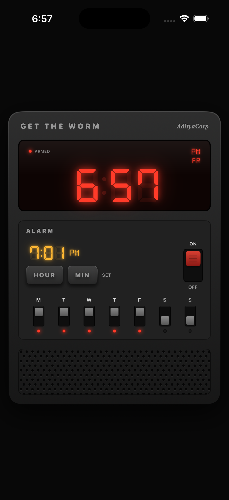
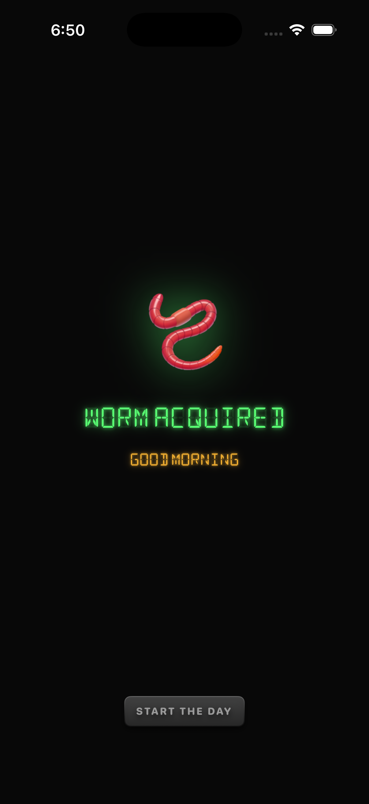

# GetTheWorm 🪱

An open-source alarm clock for iOS inspired by [erly](https://apps.apple.com/us/app/erly-wake-up-early/id6751428380) that doesn't stop ringing until you go outside and take a photo of real grass.

  
  

## How it works

1. Set an alarm and pick your weekdays.
2. The app queues 30ish alarms spaced a minute apart at the time you set using AlarmKit (so they ring through Silent Mode and Focuses, and force quit doesn't kill them since they're scheduled at the OS level).
3. Dismissing an alarm runs a background intent that schedules a new alarm in 10 seconds. 
4. To stop the alarms, you have to open the app and take a photo of grass. Pictures are classified on-device with Vision (nothing leaves your phone).
5. Once you take a good photo, the remaining alarms are cancelled and tomorrow's alarms get queued.

## Requirements

- iOS 26 or later (AlarmKit)
- Xcode 26 to build
- A real iPhone for the full experience (the camera and the Vision classifier both need real hardware)
  - In Simulator, the ringing screen shows a picker of test photos, and alarms don't automatically respawn when you dismiss them.

## Testing

There are unit tests for the alarm date math (including DST and window edge cases), display formatting, and the grass classifier on the bundled fixture photos.

## Credits

- Inspired by [erly](https://apps.apple.com/us/app/erly-wake-up-early/id6751428380).
- 7-segment and 14-segment fonts: [DSEG](https://github.com/keshikan/DSEG) by keshikan, SIL Open Font License.
- Test photos from Wikimedia Commons, see `GetTheWorm/GetTheWorm/Resources/TestPhotos/ATTRIBUTION.md`.

## License

MIT. See [LICENSE](LICENSE).
